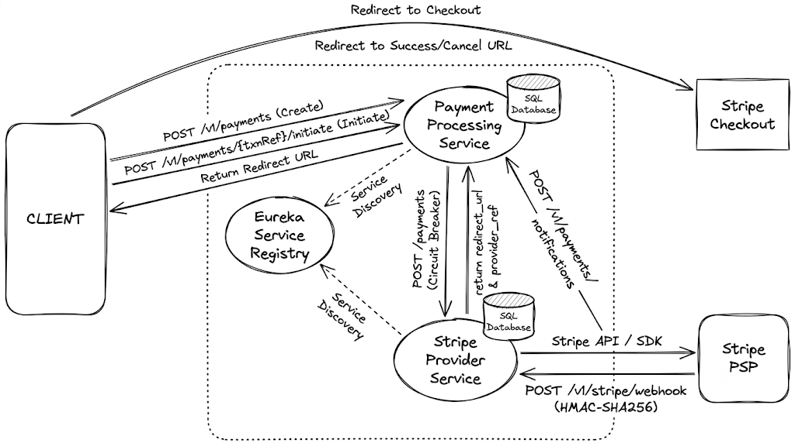

# Distributed Stripe Payment Integration System

A production-grade, distributed payment processing engine built with Spring Boot, Netflix Eureka, and Resilience4j. Designed with clean separation of concerns, strict state-machine lifecycle management, asynchronous webhook reconciliation, and circuit-breaker fault tolerance.

---

## Architecture Overview



The system isolates transaction lifecycle management from external payment gateway communication across three dedicated services:

1. **Eureka Service Registry (`:8761`)**: Central service discovery coordinating inter-service routing and client-side load balancing.
2. **Payment Processing Service (`:8082`)**: Core orchestrator managing transaction persistence in MySQL, enforcing state machine transitions (`CREATED` → `INITIATED` → `PENDING` → `SUCCESS` / `FAILED`), and maintaining historical transaction logs.
3. **Stripe Provider Service (`:8083`)**: Gateway adapter encapsulating the Stripe Java SDK, managing Checkout Session creation, and non-blocking webhook verification.

---

## Key Design Patterns & Engineering Highlights

* **State & Strategy Pattern (Lifecycle Management):** Transaction states are encapsulated into dedicated status processors (`CreatedStatusProcessor`, `InitiatedStatusProcessor`, `PendingStatusProcessor`, `SuccessStatusProcessor`, `FailedStatusProcessor`) managed via a centralized `PaymentStatusFactory`. New payment events or states can be introduced without modifying core service classes.
* **Fault Tolerance via Resilience4j:** Outbound HTTP calls from `Payment Processing Service` to `Stripe Provider Service` are protected by a `@CircuitBreaker`. If external failure rates exceed configured thresholds, executions route to fallback handlers (`fallbackProcessPayment`), returning controlled `503 Service Unavailable` signals to prevent thread pool starvation.
* **Asynchronous Webhook Ingestion:** Inbound Stripe webhook events are ingested via non-blocking handlers using `@Async`. Payloads are cryptographically verified using `HMAC-SHA256` signatures against configured webhook secrets before notifying the core processing engine.
* **Internal Reconciliation Hook:** Once verified, `Stripe Provider Service` notifies `Payment Processing Service` via `POST /v1/payments/notifications`, triggering state mutations and immutable audit logging.
* **Direct JDBC Persistence:** Opts for `NamedParameterJdbcTemplate` for explicit, optimized SQL execution and low overhead. Uses `ModelMapper` with bidirectional custom converters to map external string DTO contracts to numeric database foreign keys.

---

## Core Technology Stack

* **Language:** Java 17
* **Frameworks:** Spring Boot 3.4.2, Spring Cloud 2024.0.1 (Netflix Eureka)
* **Fault Tolerance:** Resilience4j Circuit Breaker
* **Persistence:** MySQL 8.0, Spring JDBC (`NamedParameterJdbcTemplate`)
* **Payment Gateway:** Stripe Java SDK 29.5.0
* **Utilities:** ModelMapper, Lombok, Gson, SLF4J

---

## API Endpoints

### 1. Payment Processing Service (`:8082`)

| Method | Endpoint | Description |
| :--- | :--- | :--- |
| `POST` | `/v1/payments` | Creates a new transaction record (`CREATED`). |
| `POST` | `/v1/payments/{txnReference}/initiate` | Initiates checkout session with provider (`PENDING`). |
| `POST` | `/v1/payments/notifications` | Internal callback endpoint receiving webhook reconciliations. |

### 2. Stripe Provider Service (`:8083`)

| Method | Endpoint | Description |
| :--- | :--- | :--- |
| `POST` | `/payments` | Creates a Stripe Checkout Session via Stripe Java SDK. |
| `GET` | `/payments/{id}` | Retrieves Stripe payment session details. |
| `POST` | `/payments/{id}/expire` | Expires an active checkout session. |
| `POST` | `/v1/stripe/webhook` | Ingests and verifies Stripe HMAC-SHA256 webhook signatures. |

### 3. Eureka Service Registry (`:8761`)

* Dashboard: `http://localhost:8761`

---

## Database Schema

```sql
Transaction:
  - id (BIGINT, PK, Auto-Increment)
  - user_id (INT)
  - payment_method_id (INT, FK -> Payment_Method.id)
  - provider_id (INT, FK -> Provider.id)
  - payment_type_id (INT, FK -> Payment_Type.id)
  - txn_status_id (INT, FK -> Transaction_Status.id)
  - txn_reference (VARCHAR(100), UNIQUE)
  - provider_reference (VARCHAR(100), NULL)
  - amount (DECIMAL)
  - currency (VARCHAR(3))
  - created_at (TIMESTAMP)
  - updated_at (TIMESTAMP)

Transaction_Log:
  - id (BIGINT, PK)
  - txn_id (BIGINT, FK -> Transaction.id)
  - old_status_id (INT)
  - new_status_id (INT)
  - updated_at (TIMESTAMP)

```

---

## Execution Workflow (Postman Request & Response Samples)

### 1. Create Payment Transaction

* **Endpoint:** `POST http://localhost:8082/v1/payments`
* **Headers:** `Content-Type: application/json`

**Request Body:**

```json
{
  "userId": 101,
  "amount": 50.00,
  "currency": "USD",
  "paymentMethodId": 1,
  "providerId": 1,
  "paymentTypeId": 1
}

```

**Response (`201 Created`):**

```json
{
  "status": "SUCCESS",
  "message": "Payment record created successfully",
  "data": {
    "txnReference": "txn_8f9a2b1c-7d3e-4b5a-9f0e-1a2b3c4d5e6f",
    "status": "CREATED",
    "amount": 50.00,
    "currency": "USD",
    "createdAt": "2026-11-04T09:40:00Z"
  }
}

```

---

### 2. Initiate Payment Session

* **Endpoint:** `POST http://localhost:8082/v1/payments/{{txnReference}}/initiate`
* **Headers:** `Content-Type: application/json`

**Request Body:**

```json
{
  "returnUrl": "http://localhost:3000/payment/success",
  "cancelUrl": "http://localhost:3000/payment/cancel"
}

```

**Response (`200 OK`):**

```json
{
  "status": "SUCCESS",
  "message": "Checkout session initialized",
  "data": {
    "txnReference": "txn_8f9a2b1c-7d3e-4b5a-9f0e-1a2b3c4d5e6f",
    "status": "PENDING",
    "providerReference": "cs_test_a1b2c3d4e5f6g7h8",
    "redirectUrl": "[https://checkout.stripe.com/c/pay/cs_test_a1b2c3d4e5f6g7h8](https://checkout.stripe.com/c/pay/cs_test_a1b2c3d4e5f6g7h8)"
  }
}

```

---

### 3. Stripe Webhook Ingestion (External Provider)

* **Endpoint:** `POST http://localhost:8083/v1/stripe/webhook`
* **Headers:**
* `Content-Type: application/json`
* `Stripe-Signature: t=1730713200,v1=5257a869e7ecebeda32affa62cd...`


**Sample Event Payload:**

```json
{
  "id": "evt_1Mv9qoLkdIwHu7ix7QZ6K9z1",
  "object": "event",
  "type": "checkout.session.completed",
  "data": {
    "object": {
      "id": "cs_test_a1b2c3d4e5f6g7h8",
      "payment_status": "paid",
      "amount_total": 5000,
      "currency": "usd"
    }
  }
}

```

**Response (`200 OK`):**

```json
{
  "received": true
}

```

---

### 4. Internal Webhook Reconciliation Callback

* **Endpoint:** `POST http://localhost:8082/v1/payments/notifications`
* **Headers:** `Content-Type: application/json`

**Request Body:**

```json
{
  "providerReference": "cs_test_a1b2c3d4e5f6g7h8",
  "status": "SUCCESS",
  "message": "Transaction cleared by Stripe gateway"
}

```

**Response (`200 OK`):**

```json
{
  "status": "SUCCESS",
  "message": "Transaction state updated and logged",
  "data": {
    "txnReference": "txn_8f9a2b1c-7d3e-4b5a-9f0e-1a2b3c4d5e6f",
    "status": "SUCCESS",
    "updatedAt": "2026-11-04T09:41:15Z"
  }
}

```

---

## Getting Started

### Prerequisites

* JDK 17 or higher
* Maven 3.8+
* MySQL 8.0+
* Stripe Developer Account (API keys & Webhook signing secret)

### 1. Database Setup

Execute the SQL scripts in order:

```bash
# 1. Create database schema and tables
mysql -u root -p < db/ddl-script.sql

# 2. Seed lookup tables (Payment Method, Provider, Statuses)
mysql -u root -p < db/dml-script.sql

```

### 2. Configure Environment Properties

Ensure Stripe keys and database credentials are set in your local properties files:

**`stripe-provider-service/src/main/resources/application.properties`**:

```properties
stripe.api.key=sk_test_yourStripeSecretKey
stripe.webhook.secret=whsec_yourWebhookSecret

```

**`payment-processing-service/src/main/resources/application.properties`**:

```properties
spring.datasource.url=jdbc:mysql://localhost:3306/payment_db
spring.datasource.username=root
spring.datasource.password=yourpassword

```

### 3. Build & Run Services

Start services in sequence:

```bash
# 1. Eureka Registry
cd eureka-service-registry
mvn clean spring-boot:run

# 2. Payment Processing Service
cd ../payment-processing-service
mvn clean spring-boot:run

# 3. Stripe Provider Service
cd ../stripe-provider-service
mvn clean spring-boot:run

```

